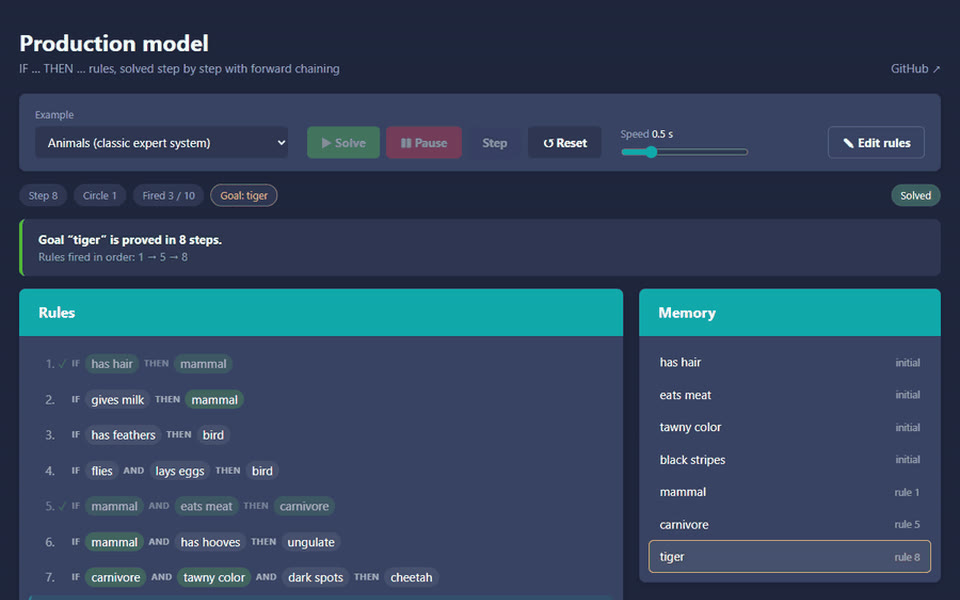
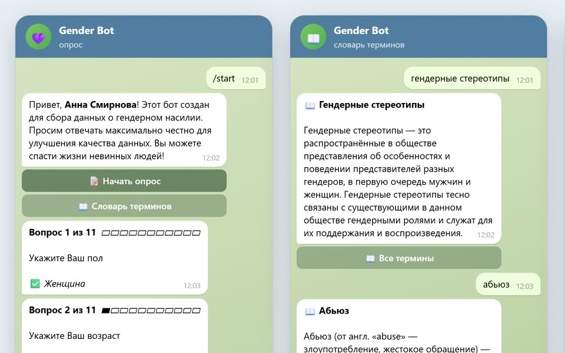
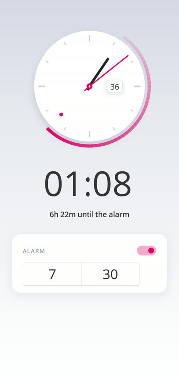

  
  
  

### 👋 About me

I build web and mobile apps, command line tools and Telegram bots, mostly
with **Python**, **TypeScript** and **C#**. I like small projects that do one thing well:
each repository here runs, has tests and a README that shows how it works.

### 🧰 Tech stack

  

### ⭐ Featured projects

<table>
  <tr>
    <td width="50%" valign="top">
      
      <h4>🎬 <a href="https://github.com/mredwardlik/cinema-night">Cinema Night</a></h4>
      Seats for an open-air movie night: a seat map, PDF tickets with QR
      codes and an operator panel.  
      
      
      
    </td>
    <td width="50%" valign="top">
      
      <h4>🎟 <a href="https://github.com/mredwardlik/eventer">Eventer</a></h4>
      Create and publish your own events: a rich text editor, a personal
      cabinet and a REST API.  
      
      
      
    </td>
  </tr>
  <tr>
    <td width="50%" valign="top">
      
      <h4>🧠 <a href="https://github.com/mredwardlik/production-model">production-model</a></h4>
      IF … THEN … rules with forward chaining and a step-by-step animation
      of the inference.  
      
      
      
    </td>
    <td width="50%" valign="top">
      
      <h4>🎓 <a href="https://github.com/mredwardlik/exam-control">exam-control</a> · <a href="https://mredwardlik.github.io/exam-control/">live demo</a></h4>
      A random exam ticket draw with smooth animations, in one HTML file
      without dependencies.  
      
      
      
    </td>
  </tr>
  <tr>
    <td width="50%" valign="top">
      
      <h4>💜 <a href="https://github.com/mredwardlik/gender-bot">gender-bot</a></h4>
      A Telegram bot with an anonymous survey on gender-based violence and a
      glossary of 64 terms.  
      
      
      
    </td>
    <td width="50%" valign="top">
      
      <h4>🍹 <a href="https://github.com/mredwardlik/cocktails-app">Cocktails App</a></h4>
      Cocktail recipes from TheCocktailDB: a single-page app built with
      Feature-Sliced Design.  
      
      
      
    </td>
  </tr>
</table>

### 📱 Mobile apps

Cross-platform apps for Android, iOS, macOS and Windows with **.NET MAUI**. Each one has its logic in
a separate library with tests and is built by GitHub Actions for Android and Windows.

<table>
  <tr>
    <td align="center" valign="top" width="25%">
      
      <h4>🌤 <a href="https://github.com/mredwardlik/weather-app">Weather App</a></h4>
      Weather now and for 4 days, city search, no API keys
    </td>
    <td align="center" valign="top" width="25%">
      
      <h4>⏰ <a href="https://github.com/mredwardlik/alarm-clock">Alarm Clock</a></h4>
      An analog dial with the time left, swipe to stop
    </td>
    <td align="center" valign="top" width="25%">
      
      <h4>🃏 <a href="https://github.com/mredwardlik/flip-card">Flip Card</a></h4>
      Travel cards with a 3D flip, search and links
    </td>
    <td align="center" valign="top" width="25%">
      
      <h4>🍽 <a href="https://github.com/mredwardlik/restaurant-app">Restaurant App</a></h4>
      A menu carousel, a cart and ordering
    </td>
  </tr>
</table>

### 🛠 Libraries and tools

<table>
  <tr>
    <th width="24%" align="left">Project</th>
    <th width="52%" align="left">What it is</th>
    <th width="24%" align="left">Stack</th>
  </tr>
  <tr>
    <td>🌊 <a href="https://github.com/mredwardlik/vue3-flow">vue3-flow</a></td>
    <td>Page flows in Vue 3 as plain objects</td>
    <td>Vue 3 · <a href="https://www.npmjs.com/package/vue3-flow">npm</a></td>
  </tr>
  <tr>
    <td>🥾 <a href="https://github.com/mredwardlik/boot-profiler">boot-profiler</a></td>
    <td>Run a project with named option profiles</td>
    <td>Node.js · <a href="https://www.npmjs.com/package/boot-profiler">npm</a></td>
  </tr>
  <tr>
    <td>📋 <a href="https://github.com/mredwardlik/pymenu">pymenu</a></td>
    <td>Console menus with arrow keys and commands</td>
    <td>Python, rich</td>
  </tr>
  <tr>
    <td>🕸 <a href="https://github.com/mredwardlik/pparser">pparser</a></td>
    <td>Parse pages the way a browser sees them</td>
    <td>Python, Playwright</td>
  </tr>
  <tr>
    <td>🔐 <a href="https://github.com/mredwardlik/rsa">rsa</a></td>
    <td>RSA keys, encryption of any length, signatures</td>
    <td>Python, PyCryptodome</td>
  </tr>
  <tr>
    <td>🔑 <a href="https://github.com/mredwardlik/pwdgenerator">pwdgenerator</a></td>
    <td>Passwords by Anderson's formula, Vigenère cipher</td>
    <td>Python</td>
  </tr>
  <tr>
    <td>🏷 <a href="https://github.com/mredwardlik/renamer">renamer</a></td>
    <td>Bulk-rename files to clean, URL-friendly names</td>
    <td>Python</td>
  </tr>
  <tr>
    <td>🔁 <a href="https://github.com/mredwardlik/loop">loop</a></td>
    <td>An async scheduler that runs steps in a loop</td>
    <td>JavaScript</td>
  </tr>
</table>

### 🤖 Bots and apps

<table>
  <tr>
    <th width="24%" align="left">Project</th>
    <th width="52%" align="left">What it is</th>
    <th width="24%" align="left">Stack</th>
  </tr>
  <tr>
    <td>🛍 <a href="https://github.com/mredwardlik/shop-telebot">shop-telebot</a></td>
    <td>A Telegram shop that sends orders to admins</td>
    <td>Python, Telegram</td>
  </tr>
  <tr>
    <td>📝 <a href="https://github.com/mredwardlik/telexam">telexam</a></td>
    <td>A Telegram bot for timed tests (prototype)</td>
    <td>Python, SQLite</td>
  </tr>
  <tr>
    <td>🗄 <a href="https://github.com/mredwardlik/dbms-turan">dbms-turan</a></td>
    <td>A desktop MySQL client for Windows</td>
    <td>Delphi, MySQL</td>
  </tr>
</table>

  Thanks for stopping by! ✨

