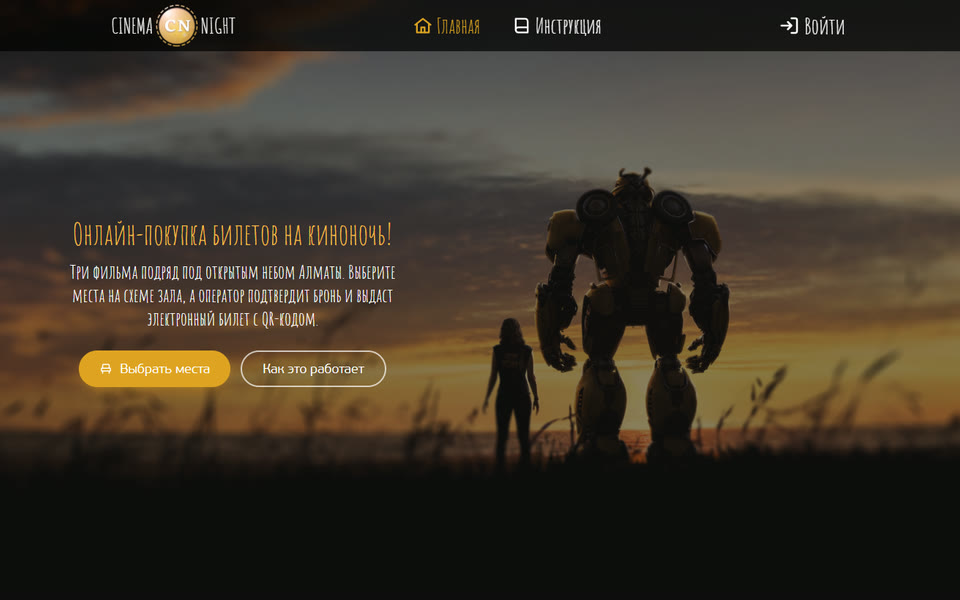
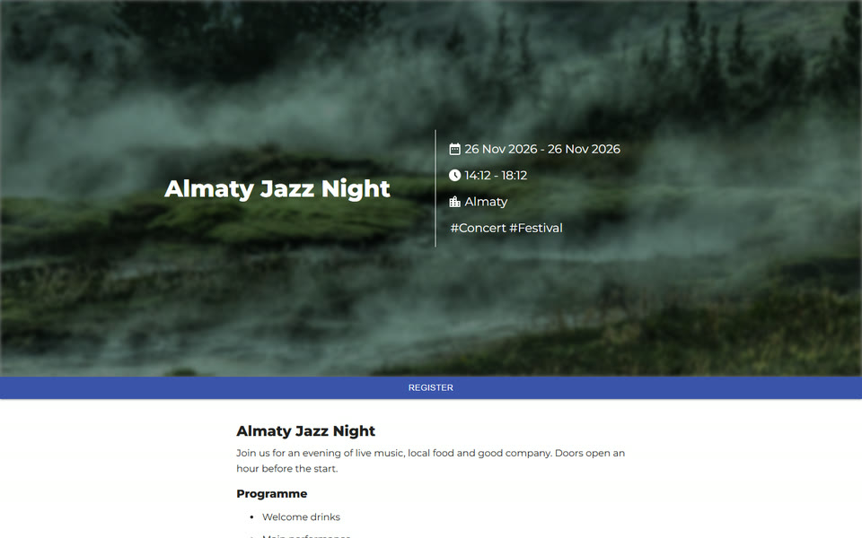
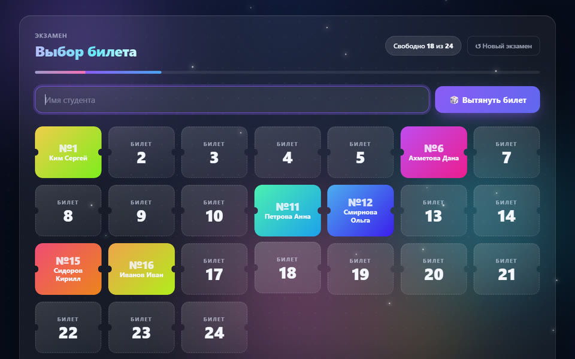
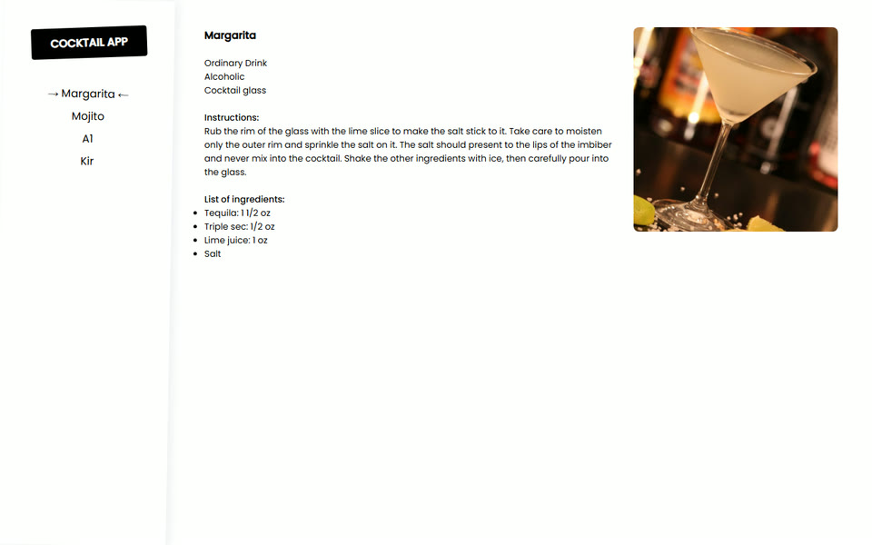
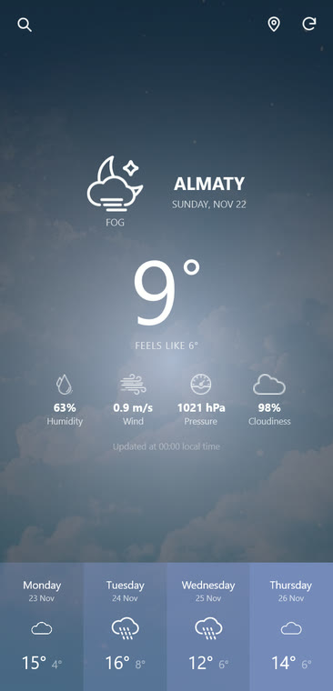
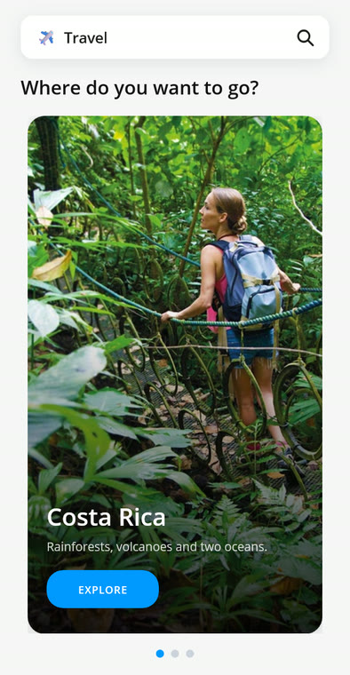
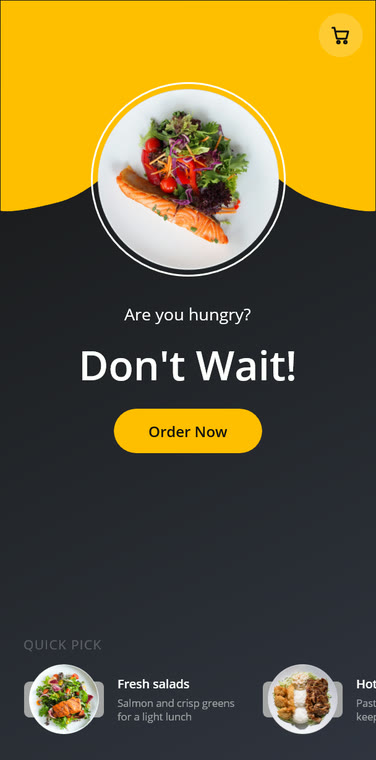

  
  
  

### 👋 About me

I build web and mobile apps, command line tools and Telegram bots, mostly
with **Python**, **TypeScript** and **C#**. I like small projects that do one thing well:
each repository here runs, has tests and a README that shows how it works.

### 🧰 Tech stack

  

### ⭐ Featured projects

<table>
  <tr>
    <td width="50%" valign="top">
      
      <h4>🎬 <a href="https://github.com/mredwardlik/cinema-night">Cinema Night</a></h4>
      Online seat booking for an open-air movie night: a seat map, tickets
      with QR codes and PDF, and an operator panel.  
      
      
      
    </td>
    <td width="50%" valign="top">
      
      <h4>🎟 <a href="https://github.com/mredwardlik/eventer">Eventer</a></h4>
      Create and publish your own events: a rich text editor, a personal
      cabinet and an API.  
      
      
      
    </td>
  </tr>
  <tr>
    <td width="50%" valign="top">
      
      <h4>🧠 <a href="https://github.com/mredwardlik/production-model">production-model</a></h4>
      IF … THEN … rules with forward chaining, and a step-by-step animation
      of the inference in the browser.  
      
      
      
    </td>
    <td width="50%" valign="top">
      
      <h4>🎓 <a href="https://github.com/mredwardlik/exam-control">exam-control</a> · <a href="https://mredwardlik.github.io/exam-control/">live demo</a></h4>
      A random exam ticket draw with animations, in one HTML file without
      dependencies.  
      
      
      
    </td>
  </tr>
  <tr>
    <td width="50%" valign="top">
      
      <h4>💜 <a href="https://github.com/mredwardlik/gender-bot">gender-bot</a></h4>
      A Telegram bot with an anonymous survey about gender-based violence, a
      glossary of 64 terms and statistics for admins.  
      
      
      
    </td>
    <td width="50%" valign="top">
      
      <h4>🍹 <a href="https://github.com/mredwardlik/cocktails-app">Cocktails App</a></h4>
      Cocktail recipes from TheCocktailDB, built with Feature-Sliced
      Design.  
      
      
      
    </td>
  </tr>
</table>

### 📱 Mobile apps

Cross-platform apps for Android, iOS, macOS and Windows with **.NET MAUI**. Each one has its logic in
a separate library with tests and is built by GitHub Actions for Android and Windows.

<table>
  <tr>
    <td align="center" valign="top" width="25%">
      
      <h4>🌤 <a href="https://github.com/mredwardlik/weather-app">Weather App</a></h4>
      Weather now and for four days, city search and location, no API keys
    </td>
    <td align="center" valign="top" width="25%">
      
      <h4>⏰ <a href="https://github.com/mredwardlik/alarm-clock">Alarm Clock</a></h4>
      An analog dial that shows the time left, swipe to stop and snooze
    </td>
    <td align="center" valign="top" width="25%">
      
      <h4>🃏 <a href="https://github.com/mredwardlik/flip-card">Flip Card</a></h4>
      Travel cards with a 3D flip, search and links to read more
    </td>
    <td align="center" valign="top" width="25%">
      
      <h4>🍽 <a href="https://github.com/mredwardlik/restaurant-app">Restaurant App</a></h4>
      A menu carousel, a cart with delivery and ordering
    </td>
  </tr>
</table>

### 🛠 Libraries and tools

| Project | What it is | Stack |
| --- | --- | --- |
| 🌊 [vue3-flow](https://github.com/mredwardlik/vue3-flow) | Page flows in Vue 3 as plain objects, without extra routes · [npm](https://www.npmjs.com/package/vue3-flow) | Vue 3 |
| 🥾 [boot-profiler](https://github.com/mredwardlik/boot-profiler) | Run a project with named profiles of typed CLI options · [npm](https://www.npmjs.com/package/boot-profiler) | Node.js |
| 📋 [pymenu](https://github.com/mredwardlik/pymenu) | Console menus made of pages, with arrow keys, numbers and commands | Python, rich |
| 🕸 [pparser](https://github.com/mredwardlik/pparser) | Parse pages the way a browser sees them, from Python or the command line | Python, Playwright |
| 🔐 [rsa](https://github.com/mredwardlik/rsa) | RSA keys, encryption of messages and files of any length, signatures | Python, PyCryptodome |
| 🔑 [pwdgenerator](https://github.com/mredwardlik/pwdgenerator) | Passwords by Anderson's formula and by templates, the Vigenère cipher | Python |
| 🏷 [renamer](https://github.com/mredwardlik/renamer) | Bulk-rename files to clean, URL-friendly names | Python |
| 🔁 [loop](https://github.com/mredwardlik/loop) | A small async scheduler that runs steps in an endless loop | JavaScript |

### 🤖 Bots and apps

| Project | What it is | Stack |
| --- | --- | --- |
| 🛍 [shop-telebot](https://github.com/mredwardlik/shop-telebot) | A Telegram shop: products are HTML files, orders go to admins | Python, Telegram |
| 📝 [telexam](https://github.com/mredwardlik/telexam) | A Telegram bot for timed multiple-choice tests (prototype) | Python, SQLite |
| 🗄 [dbms-turan](https://github.com/mredwardlik/dbms-turan) | A desktop MySQL client for Windows | Delphi, MySQL |

  Thanks for stopping by! ✨

